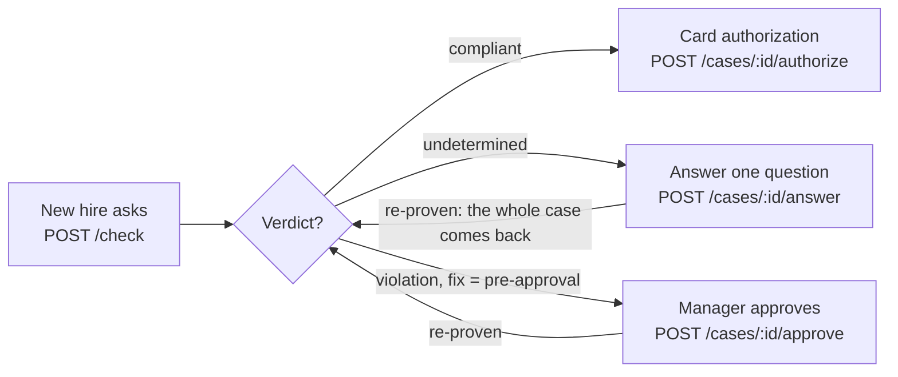

# Proof of Purchase API contract

2026-10-17 · Person A

One FastAPI server is the only thing the agent, the evaluation and the dashboard call. Every route below returns sample JSON from 15:00 today and the real engine lands behind the same routes by 20:00, so Person B can build against it now.

Live copy with comments: https://claude.ai/code/artifact/db9e4ece-6838-4ae3-9755-23881fe59240

## Environments

One variable, `API_URL`, points the agent and the evaluation at whichever server you want; default it to local.

| Environment | Base URL | Who runs it | Ready |
| --- | --- | --- | --- |
| Local | `http://localhost:8000` | you: `uvicorn api.main:app --reload --port 8000` from the repo root | as soon as the repo is pushed (before 15:00) |
| Shared dev | `http://<VULTR_IP>:8000` | Person C deploys `main` on the Vultr VM and posts the IP in team chat | stubs by 15:00 |
| Dashboard | `https://<project>.vercel.app` | Person C on Vercel | 15:00 |

Interactive docs live at `{API_URL}/docs` (Swagger, try any route in the browser) and the machine-readable schema at `{API_URL}/openapi.json`. Every shape in this doc is a Pydantic model in `api/models.py`, so the OpenAPI schema is the tie-breaker if this doc and the code ever differ.

| `.env` key | Who reads it |
| --- | --- |
| `API_URL` | B's agent and `eval/run.py`; C's dashboard |
| `TYPESAFE_API_KEY` | B, `extract/jev.py` |
| `GEMINI_API_KEY` | B, `eval/baselines.py` |
| `AGENT_SEED` | B, `agent/agent.py` |
| `SENTRY_DSN` | C, both API and dashboard |
| `POP_P_HI`, `POP_P_LO` | A's API reads them (defaults 0.7 and 0.3); B sets them after tuning on the 50-row split |

Copy `.env.example` to `.env`; `.env` is never committed. Python 3.11 and one dependency file, `pyproject.toml` at the repo root: A keeps `z3-solver fastapi uvicorn pydantic pytest httpx sentry-sdk` under `[project.dependencies]`, B appends `pandas typesafe-sdk uagents google-genai` to the same list; install with `pip install -e .`. No auth on any route and CORS is open. A stub response carries the header `X-Stub: 1` until its real route lands, so the agent can tell which one it hit.

## Routes

Fourteen routes; every body and response is JSON, and paths are relative to `API_URL`. Two routes are not in the build guide: `GET /cases/{id}` and `GET /cases?awaiting_approval=true`, added because the agent must poll a waiting case and the approvals tab must list them.

| Method and path | Body | Returns | Status codes | Used by |
| --- | --- | --- | --- | --- |
| `POST /check` | `{text, employee_id, amount?, timestamp?}` | case | 200 · 404 unknown employee · 422 bad body or `amount <= 0` | agent, dashboard Check page |
| `GET /cases/{case_id}` | – | case | 200 · 404 | agent (poll while waiting on approval), dashboard |
| `GET /cases?awaiting_approval=true` | – | `{cases: [case]}` | 200 | dashboard approvals tab |
| `POST /cases/{case_id}/answer` | `{fact, value}` | case, re-proven | 200 · 404 · 422 unknown fact, wrong type, value outside the fact's domain, or `fact = pre_approved` | agent form card, dashboard question buttons |
| `POST /cases/{case_id}/approve` | `{approver, approved}` | case with `pre_approved` set and re-proven | 200 · 404 | dashboard approvals tab |
| `POST /cases/{case_id}/authorize` | – | authorization (also stored on the case) | 200 · 404 · 409 verdict is not compliant, or `amount unknown` | dashboard |
| `GET /ledger?company=&verdict=&limit=200&offset=0` | – | `{transactions: [ledger row], total}` | 200 | dashboard Ledger page |
| `POST /ledger/audit` | `{company}` | audit summary | 200 | dashboard, agent |
| `GET /policy` | – | `{version, rules, facts}` | 200 | dashboard Rules page |
| `POST /policy/audit` | – | `{dead, conflicts}` | 200 | dashboard Rules page |
| `GET /policy/irs` | – | `{enabled, policy_version, rules, audit, summary}` | 200 | dashboard IRS page |
| `POST /policy/layers` | `{irs: bool}` | `{version, rules, facts}` | 200 | dashboard IRS page |
| `POST /bank-rules/check` | `{rules: [bank rule]}` | `{shadowed, overlaps}` | 200 · 422 | dashboard Rules page |
| `GET /eval` | – | the evaluation table, `eval/results.json` as-is | 200 | dashboard Evaluation page |
| `POST /data/reload` | – | `{transactions, employees, extractions, approvals, skipped}` | 200 | B, after refreshing the data files |
| `GET /health` | – | `{ok, policy_version, stub}` | 200 | deploy checks |
| `GET /employees/{employee_id}/rules` | – | `{employee, facts: {role, tenure_days}, rules: [{id, layer, text, applies, days_left}]}` | 200 · 404 | dashboard "What applies to you" page. `applies` false = Z3 proved the rule can never fire for this person; `days_left` is set when a rule stops applying after that many days (first-90-days rules) |

`POST /check` fields: `text` is the new hire's words; `employee_id` picks the role from the employees table; `amount` in USD is optional and, when missing, the server takes the first `$…` in the text (no model involved); `timestamp` is ISO 8601 and defaults to now in Los Angeles; a date-only `YYYY-MM-DD` is accepted but leaves `hour` unknown, so the late and early meal rules go undetermined instead of firing at midnight. `amount` must be > 0. `POST /cases/{id}/answer` accepts any schema fact except `pre_approved`, which only `/approve` sets; the value must be in the fact's domain (amount > 0, hour 0–23, an enum value from its list). `/authorize` is idempotent: a second call returns the same `auth_id` and `proof_hash`; it answers 409 `amount unknown` on a compliant case whose amount was never given.

## The case

Every route that touches a purchase returns this one shape, re-proven by Z3 on every call, so a card built once renders everywhere. This is the demo dinner right after `POST /check`:

```json
{
  "case_id": "c_8f2a1b3c",
  "created_at": "2026-10-17T19:30:00-07:00",
  "employee_id": "e_newhire",
  "text": "Client dinner Thursday with Acme's CFO, about $48.",
  "policy_version": "a1b2c3d4e5f6",
  "verdict": "violation",
  "facts": {
    "role":            {"value": "employee", "source": "employee",  "p": null},
    "expense_kind":    {"value": "meal",     "source": "jev",       "p": 0.97},
    "client_present":  {"value": true,       "source": "jev",       "p": 0.91},
    "at_company_event":{"value": false,      "source": "jev",       "p": 0.08},
    "amount":          {"value": 48,         "source": "text",      "p": null},
    "hour":            {"value": 19,         "source": "derived",   "p": null},
    "days_since_purchase": {"value": 0,      "source": "derived",   "p": null},
    "pre_approved":    {"value": false,      "source": "approvals", "p": null},
    "coded_account":   {"value": "meals_50", "source": "rules",     "p": null}
  },
  "violations": [
    {"rule": "3.4", "layer": "company",
     "text": "Any expense over $35 needs manager pre-approval.",
     "because": ["amount", "pre_approved"]}
  ],
  "applied": [],
  "fix": [{"fact": "pre_approved", "from": false, "to": true}],
  "questions": [],
  "explanation": "Any expense over $35 needs manager pre-approval (rule 3.4): amount $48, no pre-approval. Fix: get manager pre-approval. Post it as meals_50 (IRS-meal).",
  "awaiting_approval": true,
  "approval": null,
  "authorization": null
}
```

| Field | Type | Meaning |
| --- | --- | --- |
| `verdict` | `compliant` · `violation` · `undetermined` | The solver's answer. `undetermined` means it depends on a fact nobody knows yet. |
| `facts` | map of fact → `{value, source, p}` | Only known facts appear; an unknown fact is simply absent. `source` is one of `jev`, `user`, `text`, `employee`, `approvals`, `ledger`, `derived`, `rules`, `answer`, `product`. `p` is Jev's probability, null for everything else. |
| `facts.coded_account` with `source: rules` | | The account the IRS coding rules force for this purchase; the ledger posts it there. Absent when the rules allow more than one (then a question decides it). |
| `violations[]` | `{rule, layer, text, because}` | Every broken rule, not just the first; `because` names the facts in Z3's unsat core. |
| `applied` | rule ids | Only for `compliant`: the rules whose conditions applied and held. |
| `fix` | list of `{fact, from, to}`, or `null` | Cheapest set of changes the person controls. `from` is null when the fact was unknown. An amount step reads as "keep it at or under `to`". `null` means no change the person controls makes it compliant. Empty list when there is nothing to fix. |
| `questions[]` | `{fact, text, p, options}` | Only for `undetermined`, ordered so the first one is the one worth asking. `options` lists the allowed values for an enum fact, null for yes/no. If no yes/no fact decides it, the one entry names the missing `amount` or `expense_kind`. |
| `explanation` | string | Filled from templates using rule text and `because`; never model-written. Safe to show verbatim. |
| `awaiting_approval` | bool | True while the fix is pre-approval and no manager has decided. Flips to false on `/approve` either way. |
| `approval` | `{approver, approved, at}` or null | The latest manager decision. `approved: false` leaves the verdict a violation. |
| `authorization` | authorization or null | Set after a successful `/authorize`. |
| `product` | product or null | Set when the text links to a known store (Amazon, Best Buy, Walmart, Target, Apple, Newegg, eBay, B&H, Home Depot, Costco, Staples, Office Depot, Dell, Micro Center, Etsy, IKEA, Wayfair): `{url, vendor, title, price, category, image, error}`. The page price becomes `amount` with source `product` unless an amount was given; the title and category are appended to what the model reads; `error` explains an unreadable page. |

Fact values and types: `role` ∈ employee, contractor, intern · `expense_kind` ∈ airfare, train, car_rental, lodging, rideshare, parking, meal, internet, phone, coworking, equipment, laptop, personal_device, office_supplies, books, development, gift, shipping, software, swag, other · `coded_account` ∈ meals_50, meals_100, travel, office, other · `amount` number (USD) · `hour` 0–23 · `days_since_purchase`, `days_before_travel`, `tenure_days` (days since the employee's `start_date`, source `employee`) integers ≥ 0 · `attendees`, `nights`, `days` integers ≥ 1 · `receipt_attached`, `pre_approved`, `approved_issue`, `booked_via_navan`, `client_present`, `at_company_event`, `traveling`, `round_trip`, `government_present` booleans. A rule may compare a per-unit amount, `{"per": ["amount", "attendees"]}`, in place of a fact name. Questions for integer facts have `options: null` like yes/no ones; the dashboard renders amount, attendees, nights, days and days_before_travel as number inputs.

## Other response shapes

Six more shapes cover everything that is not a case. Field names are final; `/docs` shows each as a model.

**Authorization** (`POST /cases/{id}/authorize`): `proof_hash` is the SHA-256 of the case's fact values, policy version and verdict, so a card limit traces back to the exact proof. When the Visa sandbox arrives, only this route's internals change.

```json
{"auth_id": "auth_3c9d2e1f", "amount_limit": 48, "merchant_category": "5812 Eating places",
 "expires_at": "2026-10-18T19:30:00-07:00", "proof_hash": "9f86d081884c7d659a2feaa0c55ad015a3bf4f1b2b0b822cd15d6c15b0f00a08"}
```

**Ledger row** (`GET /ledger`, and each entry of `top_violations`): the transaction's own columns plus its verdict, the broken rule ids, and the full case so the detail drawer and the agent reuse the case card.

```json
{"txn_id": "t_000412", "company": "demo", "employee_id": "e_newhire", "vendor": "Nobu", "memo": "NOBU LA",
 "amount": 210, "timestamp": "2026-09-20T20:30:00-07:00", "qb_category": "Travel", "coded_account": "travel",
 "verdict": "violation", "violations": ["3.4", "IRS-meal"], "case": { "...": "a case, as above" }}
```

**Audit summary** (`POST /ledger/audit`): cached per policy version, so the second call is instant.

```json
{"company": "demo", "policy_version": "a1b2c3d4e5f6", "n": 1240,
 "by_verdict": {"compliant": 1061, "violation": 142, "undetermined": 37},
 "by_rule": [{"rule": "3.4", "text": "Any expense over $35 needs manager pre-approval.", "count": 88}],
 "top_violations": ["up to 20 ledger rows"], "elapsed_ms": 1830}
```

**Policy** (`GET /policy`) returns `{version, rules, facts}` where `rules` is the raw rule list and `facts` the schema:

```json
{"version": "a1b2c3d4e5f6",
 "rules": [{"id": "5.2", "layer": "company",
            "text": "Interns get no transport reimbursement except at company events.",
            "when": {"and": [{"eq": ["role", "intern"]}, {"in": ["expense_kind", ["rideshare", "airfare"]]}]},
            "require": "at_company_event"}],
 "facts": {"role": {"kind": "enum", "values": ["employee", "contractor", "intern"], "mutable": false}}}
```

`POST /policy/audit` returns `{"dead": ["rule ids whose condition no transaction can meet"], "conflicts": [{"a": "X", "b": "Y", "example": {"role": "intern", "expense_kind": "meal"}}]}`; `example` is a full fact map for a transaction that triggers both rules.

`GET /policy/irs` runs the IRS layer's self-test with Z3 on every call and returns `{enabled, policy_version, rules, audit, summary}`. Each entry of `rules` is the raw rule (`id, layer, text, cite, url, when, require`) plus `facts_used`, `prohibition` (require is `false`), `breaks` and `holds` (witnesses: `{facts, verdict, violations, because, applied, also}`, where `facts` is a full fact map Z3 built, `because` maps rule → unsat core, `also` lists other rules the breaker unavoidably trips; `holds` is null for a prohibition), `implied_by` (company rule ids that already force it, `[]` when only the IRS layer catches it) and `ms`. `audit` is the dead/conflicts check restricted to IRS rules; `summary` is `{rules, implied_by_company, irs_only, prohibitions}`. The report covers the full pack even while the layer is off.

IRS rules never decide a case. A case's `verdict`, `violations`, `fix` and `questions` come from the company layer; IRS rules that are not met appear in `irs_notes` (same shape as `violations`) and the derived `coded_account` and `deductible` facts carry the coding. A ledger row has `notes` (rule ids) beside `violations`, and the audit's `by_rule` counts both.

`POST /policy/layers` with `{"irs": false}` swaps the live policy to the company layer plus dashboard rules (a new `version`; `/health` follows); `{"irs": true}` restores it. In memory only: a restart turns the layer back on.

**Bank-rule check** (`POST /bank-rules/check`). Input is QuickBooks' own model: description contains every word, amount in a range, assign a category, first match in list order wins.

```json
{"rules": [{"id": "r1", "contains": ["UBER"], "category": "Travel"},
           {"id": "r2", "contains": ["UBER", "EATS"], "amount_min": 0, "amount_max": 60, "category": "Meals"}]}
```

returns `{"shadowed": [{"rule": "r2", "by": ["r1"]}], "overlaps": [{"a": "r1", "b": "r2", "example": {"description": "UBEREATS", "amount": 12.5}}]}`. Overlaps between unrelated words ("UBER" vs "AMAZON") are filtered out server-side.

**Evaluation** (`GET /eval`) serves `eval/results.json` unchanged, so Person B owns this shape end to end; the API only validates it:

```json
{"as_of": "2026-10-18T09:40:00-07:00", "n_heldout": 150,
 "systems": [{"name": "Jev + Z3", "accuracy": 0.94, "citation_f1": 0.91, "rerun_agreement": 1.0,
              "median_latency_ms": 140, "cost_per_1k_usd": 0.32, "questions_per_txn": 0.18}]}
```

`systems` carries one entry each for `Keyword rules`, `LLM judge`, `LLM facts + Z3`, `Jev + Z3`, in that order.

## Case lifecycle

Only a compliant case reaches `/authorize`. A case loops through the verdict until it is compliant; only then does the dashboard's Authorize button issue the mock card, and the agent reads the `authorization` off the polled case.



Any other fix (spend less, attach a receipt) shows on the case; a changed request goes through `POST /check` again. Poll `GET /cases/:id` while a case waits for approval; `awaiting_approval` turns false once the manager decides.

## What the API needs from Person B

The API imports two functions and reads five files from B's folders; nothing else crosses the lane. Until each lands, the API falls back to a keyword stub so it always starts.

**Two Python functions**, imported by name, so the signatures are the contract:

```python
# extract/jev.py
def extract(text: str) -> dict[str, dict]:
    """One Jev call per fact. Synchronous; the API runs it in a thread.
    Enum fact  -> {"value": <one of the enum values>, "p": <probability of that value>}
    Yes/no fact -> {"p": <probability of YES>}
    Return only the three model facts; amount, time and role never come from a model."""
    return {
        "expense_kind":     {"value": "meal", "p": 0.97},
        "client_present":   {"p": 0.91},
        "at_company_event": {"p": 0.08},
    }

# extract/mapping.py
def coded_account_for(qb_category: str) -> str:
    """QuickBooks category -> one of meals_50, meals_100, entertainment_0, travel, office, other.
    Unknown category -> "other". Every category in data/SCHEMA.md must map."""
```

The API turns probabilities into facts with fixed thresholds: known when `p >= 0.7` or `p <= 0.3`, otherwise unknown and the solver treats it as free. Tune those two numbers on the 50-row tuning split, not inside `extract()`; the API reads them from `POP_P_HI` and `POP_P_LO` in `.env` (defaults 0.7 and 0.3), so tuned values reach `/check` and the audit without a code change.

**Five files**, all UTF-8, read from the repo root at API startup and again on `POST /data/reload` (no restart needed; the response lists what loaded and what was skipped, with a reason per row). A re-loaded row whose columns or extraction changed drops its cached verdicts and is re-decided; unchanged rows keep theirs:

| File | Columns or shape | Notes |
| --- | --- | --- |
| `data/employees.csv` | `employee_id,name,role,manager_id,job_title,department,level,location,start_date` | Worker-shaped record (Workday's sample fields). `role` ∈ employee, contractor, intern. `start_date` ISO date; the API derives `tenure_days` from it at the purchase date, and the first-90-days rules 10.1–10.3 read that fact. The five worker columns may be blank; a blank `start_date` leaves `tenure_days` unknown. `POST /employees` accepts the same optional fields and defaults `start_date` to today. Keep the four demo ids: `e_newhire` (employee), `e_intern`, `e_contractor`, `e_manager` (employee, no manager). The API seeds these if the file is missing. |
| `data/transactions.csv` | `txn_id,company,employee_id,vendor,memo,amount,timestamp,qb_category,receipt_attached,receipt_date,source` | `timestamp` ISO 8601 with offset and a time part whenever the source has one (a date-only value leaves `hour` unknown); `receipt_attached` 0 or 1; `receipt_date` ISO date or empty; `source` ∈ intuit, injected. `amount` must be > 0: refunds and credits are skipped and listed under `skipped` in the reload response. Blank `receipt_attached` means unknown, not 0. `txn_id` unique across companies (prefix it with the company); re-loading upserts by `txn_id`. |
| `data/extractions.jsonl` | one line per transaction: `{"txn_id": "t_000412", "facts": <extract() output>}` | Run `extract(memo)` offline once and write it here; the ledger audit reads this instead of calling Jev live. A transaction without a line is audited with those facts unknown. |
| `data/approvals.csv` | `txn_id,approver,approved_at` | Pre-approvals that exist in the ledger history. A listed `txn_id` gets `pre_approved = true`. Reloading replaces the file-sourced approvals rather than appending. |
| `data/eval_labels.csv` | `txn_id,expected_verdict,expected_rules,split` | `expected_rules` joined with `;` (empty when compliant); `split` ∈ tune, heldout (50 / 150). The API never reads this; `eval/run.py` does. |

**One output** the API serves verbatim: `eval/results.json` in the Evaluation shape above. Write it from `eval/run.py`; `GET /eval` returns it the moment the file exists.

**What B imports from A** for the evaluation, so all four systems are scored on the same facts and the same solver:

```python
from api.cases import decide_transaction   # (txn: dict, extraction: dict | None, pre_approved: bool, employee: dict | None) -> case dict
from engine.keyword_baseline import keyword_verdict   # (txn: dict, pre_approved: bool = False) -> {"verdict": ..., "rules": [...]}
from engine.rules import load_policy, facts_from_probs
```

`decide_transaction` is exactly what the ledger audit runs, so "Jev + Z3" in the table is the production path; "LLM facts + Z3" is the same call with Gemini's probabilities passed as `extraction`. `txn` is one `transactions.csv` row as a dict; both functions accept the raw CSV row with every column still a string, so no conversion is needed before calling them.

## Conventions

FastAPI defaults everywhere, so there is nothing to learn beyond this list.

- **Errors** are `{"detail": "..."}` with the status codes in the Routes table; 422 bodies carry FastAPI's field-level list under `detail`.
- **Ids**: `case_id` is `c_` + 8 hex, `auth_id` is `auth_` + 8 hex, `policy_version` is 12 hex (a hash of the rule JSON, so it changes whenever a rule changes). `txn_id` is whatever `transactions.csv` says. Put `case_id` in every agent card payload, as the build guide asks.
- **Timestamps** are ISO 8601 strings with an offset; a naive timestamp is read as Los Angeles time. `expires_at` on an authorization is 24 hours after it was issued.
- **Money** is a JSON number in USD, at most two decimals.
- **Stubs** carry `X-Stub: 1` and a fixed `policy_version` of `stub00000000`; the real routes drop the header. `GET /health` reports `stub: true` while any route is still a stub.
- **No auth, open CORS**, no rate limits; every call is synchronous and returns within a second, including `/check`, which runs Jev once per fact.
- **Re-proving**: `/answer` and `/approve` re-run the full proof and return the whole case; never patch a case locally.
- **Demo employees** the agent can offer when a user has no id: `e_newhire` (the new hire), `e_intern`, `e_contractor`; `e_manager` approves. Any other id must exist in `data/employees.csv`.
- **Agent flow**: `POST /check` → if `questions` is non-empty, show a `form` card for `questions[0]` and `POST /answer` → if `awaiting_approval`, say so and poll `GET /cases/{id}` every few seconds until it flips → if `compliant`, the dashboard's Authorize button issues the mock card; the agent shows the `authorization` from the polled case.

## What is live when

Build the agent and the evaluation against the stubs now; each step below swaps real behaviour in behind the same routes with no shape change.

1. **15:00 today**: every route answers with the sample JSON above and `X-Stub: 1`. The agent can render cards; the eval harness can call `decide_transaction` only after step 2.
2. **20:00**: `POST /check`, `GET /cases/{id}`, `GET /cases`, `/answer`, `/approve`, `/authorize` are real, using `extract()` if `extract/jev.py` exists and the keyword stub if not. `decide_transaction` and `keyword_verdict` are importable.
3. **02:00**: `GET /ledger`, `POST /ledger/audit`, `GET /policy`, `POST /policy/audit`, `POST /bank-rules/check`, `POST /data/reload` are real on whatever `data/transactions.csv` and `data/extractions.jsonl` hold. Full company and IRS rule packs loaded.
4. **When `eval/results.json` exists**: `GET /eval` serves it, and `/health` reports `stub: false`.

If the API is down or a route misbehaves, ping Person A with the request body and the `detail` string; a change to any shape in this doc gets announced in team chat before it ships.
