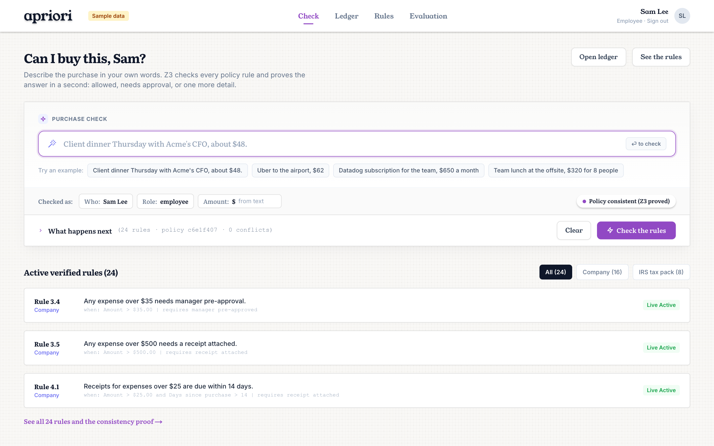
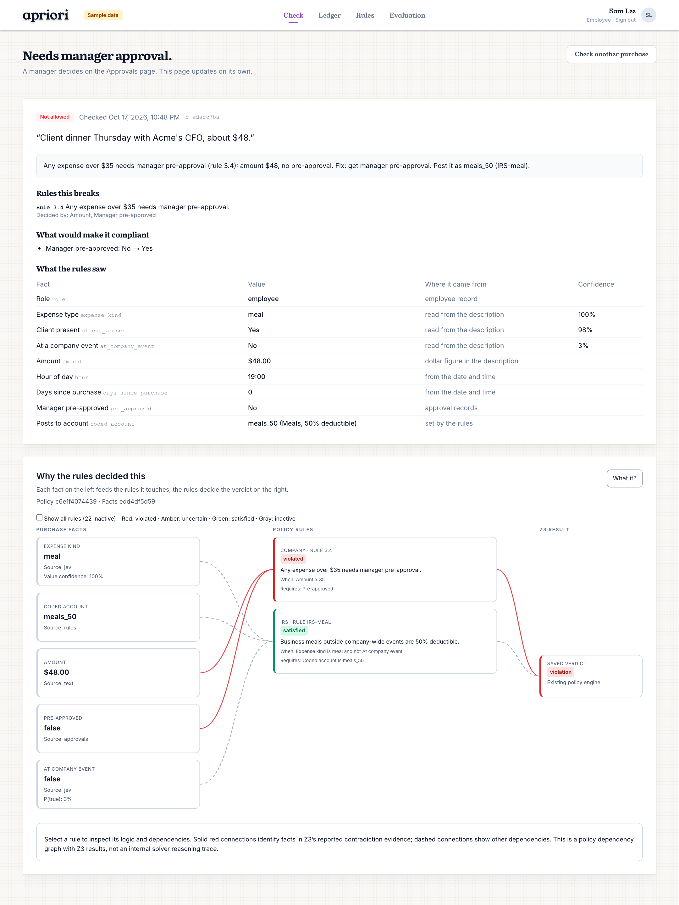
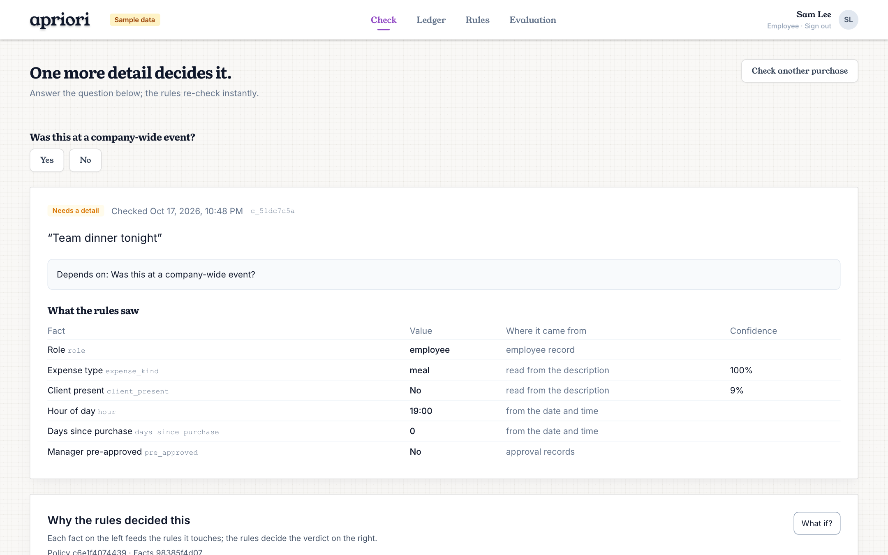
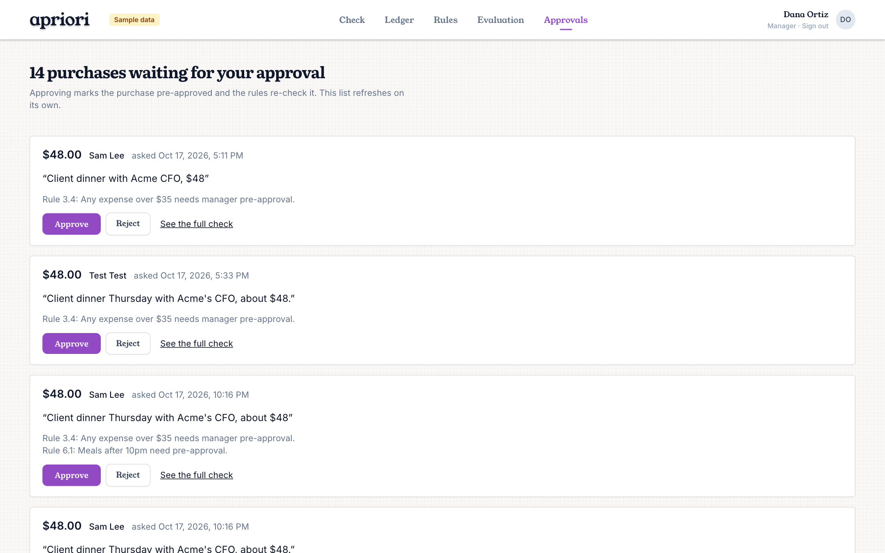
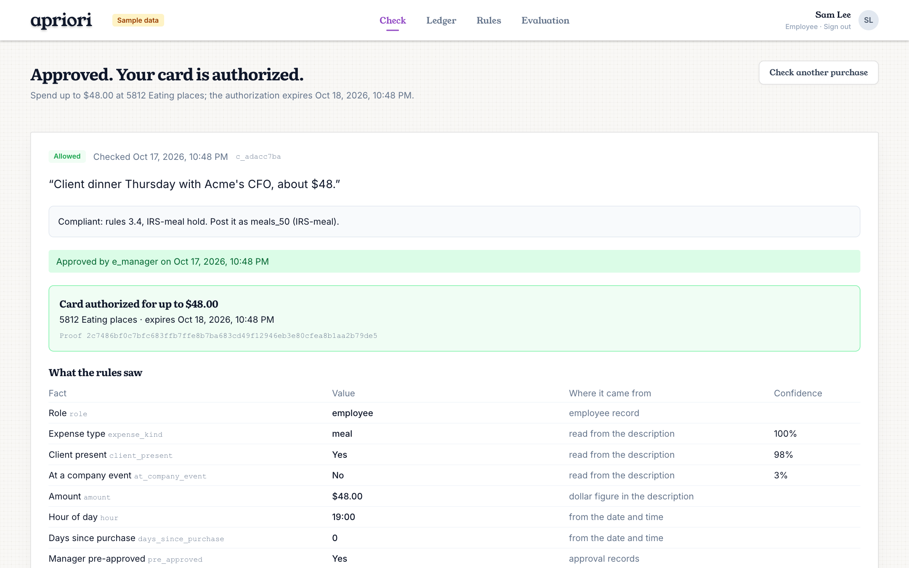
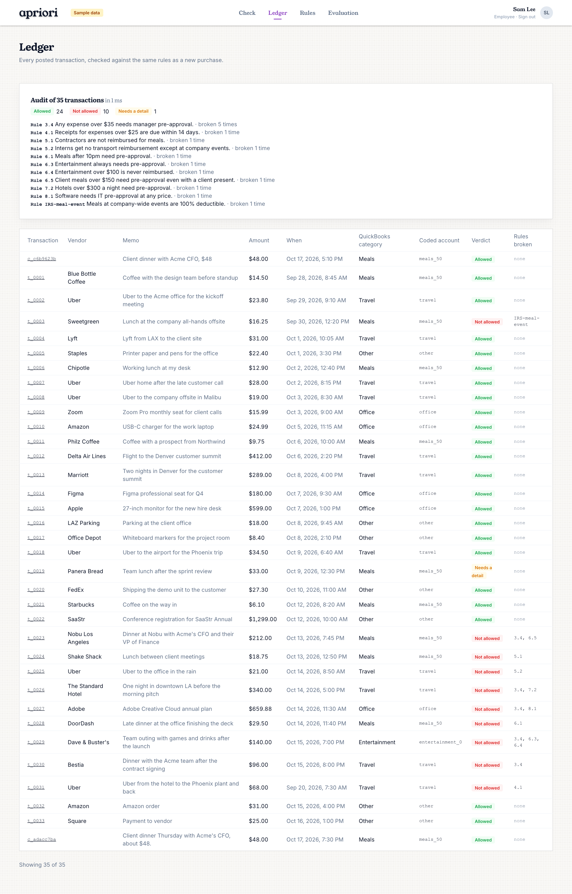
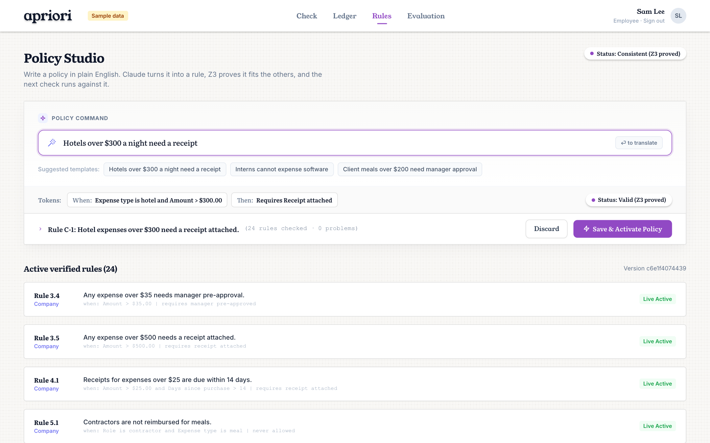
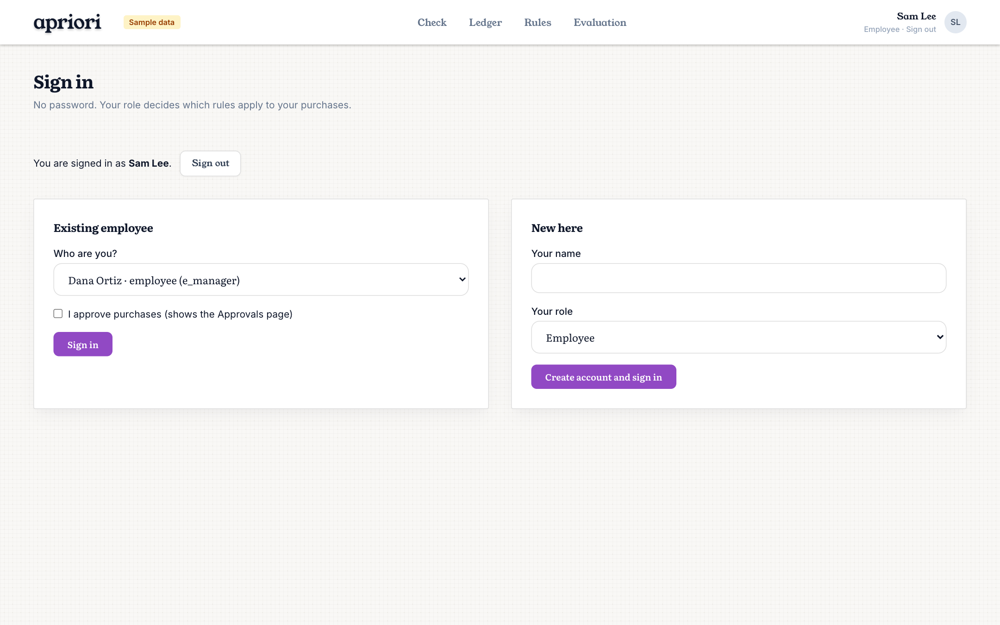

# apriori · Proof of Purchase

**Ask "can I buy this?" in plain English and get an answer that is proven, not guessed.**

A new hire types *"Client dinner Thursday with Acme's CFO, about $48."* A small typed model reads that sentence into facts. The [Z3 SMT solver](https://github.com/Z3Prover/z3) checks those facts against every company and IRS rule at once and returns one of three verdicts: **allowed**, **not allowed** (with the exact rules broken and the cheapest fix), or **needs one more detail** (with the single question that decides it). A manager approves on the dashboard, a mock card authorization is issued for exactly that amount with a hash of the proof, and the purchase lands in a QuickBooks-shaped ledger that the same rules audit in full.

Built at LA Hacks 2026 for the Intuit QuickBooks track. Z3 makes every decision; models only read messy text into facts.



---

## Contents

- [How it works](#how-it-works)
- [Features](#features)
- [Why not an LLM, RAG, or if/else?](#why-not-an-llm-rag-or-ifelse)
- [Run it](#run-it)
- [Repo layout](#repo-layout)
- [API](#api)
- [Data and known limits](#data-and-known-limits)

---

## How it works

One FastAPI server holds all of the logic. The Next.js dashboard, the text-message approver, and the CLI are thin clients of it, so they can never disagree.

```
  "Client dinner Thursday with Acme's CFO, about $48."
                        │
                        ▼
  ┌──────────────────────────────────────────────────────────────┐
  │ 1. READ                                                      │
  │   Jev (Typesafe System One)    →  expense_kind = meal  p=1.00│
  │   one typed question per fact      client_present   p=0.98   │
  │                                    at_company_event p=0.03   │
  │   regex / form / records       →  amount = 48, hour = 19,    │
  │                                    role = employee, ...      │
  └──────────────────────────────┬───────────────────────────────┘
                                 ▼
  ┌──────────────────────────────────────────────────────────────┐
  │ 2. DECIDE  (Z3)                                              │
  │   27 rules, each  when(facts) ⇒ require(facts)               │
  │   • unknown facts stay free variables                        │
  │   • violation  → every broken rule + its unsat core          │
  │   • compliant  → the rules that applied and held             │
  │   • undetermined → the yes/no fact whose answer flips it     │
  │   • derived facts (coded_account = meals_50) forced by rules │
  └──────────────────────────────┬───────────────────────────────┘
                                 ▼
  ┌──────────────────────────────────────────────────────────────┐
  │ 3. RESOLVE                                                   │
  │   fix = smallest change you control (Z3 Optimize, MaxSAT)    │
  │   "get manager pre-approval" → waits on the Approvals page   │
  │   "was this at a company event?" → one button, re-proven     │
  └──────────────────────────────┬───────────────────────────────┘
                                 ▼
  ┌──────────────────────────────────────────────────────────────┐
  │ 4. PAY & POST                                                │
  │   mock card auth: limit $48, MCC 5812, expires in 24h,       │
  │   proof_hash = sha256(facts, policy_version, verdict)        │
  │   row posted to the ledger as meals_50                       │
  └──────────────────────────────┬───────────────────────────────┘
                                 ▼
  ┌──────────────────────────────────────────────────────────────┐
  │ 5. AUDIT                                                     │
  │   the same rules run over every ledger row (35 rows: 1 ms)   │
  └──────────────────────────────────────────────────────────────┘
```

**1. Read.** The request text goes to [Jev](https://typesafe.ai) (Typesafe's "System One" model) with one typed question per fact: a `choice` question for the expense kind, and `noul` (yes/no) questions for *client present* and *at company event*. Jev returns calibrated probabilities, never free text. A probability at or above 0.85 (or at or below 0.15) becomes a known fact; anything in between stays **unknown**. Amount, time of day, days since purchase, role, tenure and prior approvals come from the form, the clock and the employee records, never from a model. The exact question wording lives in [api/jev_live.py](api/jev_live.py) and was tuned on a labeled set with [api/bench_jev.py](api/bench_jev.py) (45/45 expense kinds, zero confidently-wrong booleans). Without a `TYPESAFE_API_KEY` a keyword stub stands in, and the dashboard labels those facts as read from text rather than from the model.

**2. Decide.** Every rule is JSON of the form `when ⇒ require` over eleven typed facts (see [engine/demo_policy.json](engine/demo_policy.json) and [engine/irs_pack.json](engine/irs_pack.json)). [engine/rules.py](engine/rules.py) compiles the packs once into Z3 formulas. For a case, the known facts are asserted as equalities and unknown facts are left free:

- If no assignment of the unknowns satisfies all rules, the verdict is **violation**. Each failing rule is re-checked with tracked assumptions and `core.minimize` so the unsat core names exactly the facts that decided it ("amount, pre_approved").
- If every assignment satisfies all rules, the verdict is **compliant**, and the rules whose conditions held are listed as applied.
- Otherwise the verdict is **undetermined**: it depends on something nobody knows yet.

Facts the rules force (like which account a meal posts to) are derived by asking Z3 which values remain satisfiable, so the IRS coding comes out of the same proof.

**3. Resolve.** For a violation, the fix is the cheapest set of changes the person controls, found with `z3.Optimize` as soft constraints weighted by effort (changing the amount costs more than attaching a receipt). Open bounds are closed to whole cents, so "under $75" becomes $74.99, not "75 minus epsilon". When the fix is "get pre-approval" the case waits on the manager's Approvals page. For an undetermined case, each unknown yes/no fact is tried both ways; the ones whose answer changes the outcome become questions, sorted by how unsure the model was. Every answer or approval re-runs the whole proof; nothing is patched locally.

**4. Pay and post.** A compliant case gets a mock card authorization: amount limit, merchant category code, 24-hour expiry, and a SHA-256 over the fact values, policy version and verdict. The authorization is idempotent and the row is posted to the ledger with the account the rules required.

**5. Audit.** The ledger view runs `decide_transaction` over every row in `data/transactions.csv`, cached per policy version, so the new purchase and the whole history are judged the same way.

---

## Features

### Purchase check

Describe the purchase in your own words. The signed-in employee's role, the amount in the text (or the amount box), and the current time all become facts. Example chips cover the main paths. Paste a product link instead (Amazon, Best Buy, Walmart, Target, Apple and other big stores) and the page's title, price and category become the description and the amount: an iPad link is checked as a $393 equipment purchase, with the product shown on the case.


### Verdict, cited rules, and the cheapest fix

The case page says the answer in words, lists every rule it breaks with the facts that decided it, and shows what would make it compliant. The **What the rules saw** table shows each fact's value, where it came from (model, text, employee record, approvals, derived) and the model's confidence.

Below it, **Why the rules decided this** is a dependency graph from facts to rules to verdict. Red wires are the facts in Z3's unsat core; gray rules never fired. Tick *Show all rules* to see that all 27 ran. **What if?** lets you override any fact and preview the re-proven verdict without saving anything.



### One question when it depends

When the verdict is undetermined, the page asks only the question that decides it. Answering re-proves the case instantly.



### Manager approvals

Managers see every case waiting on pre-approval, with the rule that put it there. Approve or reject. The list refreshes itself every five seconds, and the employee's case page flips on its own.



Approval also works over iMessage. The [photon/](photon/) sidecar texts the manager each waiting case and turns a YES or NO reply into the same approve call.

### Card authorization with a proof hash

Once compliant, **Authorize card** issues the mock authorization: the exact limit, the merchant category, the expiry, and the hash of the proof it rests on. A real card control would get the same limits.



### Ledger audit

Every posted transaction, checked by the same rules as a new purchase. The summary counts verdicts and groups violations by rule. Click a transaction to open its full case and graph.



### Policy Studio: rules in plain English, proven consistent

Type a policy sentence. Claude turns it into a `when ⇒ require` rule over the known facts, Z3 compiles it, checks it against the other 27 rules for conflicts and dead conditions, and shows the result before anything is saved. **Save & Activate** swaps the live policy; the next check proves against it. The page also proves the whole policy consistent: no rule that can never fire, no two rules that disagree on the same purchase (with a concrete example when they do).



### What applies to you

A personal policy briefing for the signed-in employee, proven rather than written. Z3 takes the two facts the employee record decides, role and tenure, and asks of every rule whether it can still fire for this person. Rules that can never apply (an intern rule for an employee) are listed as such. The first-90-days rules carry a countdown: the solver maximizes `tenure_days` under the rule's condition, so "for 64 more days" is a bound, not an estimate. The page also states what the system will not do: decide pay, employment or access, or authorize a card on a non-compliant proof.

The employee record is Worker-shaped (job title, department, level, location, start date, manager), and `tenure_days` is derived from the start date at the purchase date, so the probation rules (equipment and hotels need pre-approval at any price, no entertainment) apply to the new hire and not to the director without anyone saying so.

### Bank rules

Paste QuickBooks bank rules (description contains words, amount in a range, assign a category, first match wins), one per line. `POST /bank-rules/check` uses Z3 string theory to find rules that can never fire because an earlier rule shadows them, and pairs that overlap, with a concrete example transaction that triggers both. The page ships with a realistic set that has two shadowed rules and one overlap.

### Sign in as anyone

No passwords. Pick an employee, intern, contractor or manager, or create one. The role decides which rules apply; the manager flag shows the Approvals page.



### Evaluation

The Evaluation page serves `eval/results.json`, produced by `python -m eval.run`: 107 held-out purchases built from the human-labeled texts in [api/bench_jev.py](api/bench_jev.py) crossed with structured contexts (role, tenure, hour, approval, receipt). Gold verdicts come from [eval/gold.py](eval/gold.py), an independent three-valued interpreter over the rule JSON that shares no code with the Z3 engine, and it agrees with Z3 on every case. Four systems are scored on verdict accuracy, rule-citation F1, rerun agreement, median latency, cost per 1,000 checks and questions asked: Keyword rules, LLM judge (Claude deciding directly), LLM facts + Z3 (Claude reading facts, Z3 deciding) and Jev + Z3. Jev + Z3 matches the LLM judge on accuracy at about 2% of the cost and 2% of the latency, with every rerun identical. Person B's separate data loader and benchmark harness over the Intuit archive are documented in [docs/backend.md](docs/backend.md).

---

## Why not an LLM, RAG, or if/else?

Three ways people usually build this, and what each one cannot do.

| | if/else or keyword rules | LLM judge (with or without RAG) | **apriori: typed model + Z3** |
| --- | --- | --- | --- |
| Reads messy text | Regex on the memo | Yes | Yes (Jev, calibrated probabilities) |
| Says "I don't know" | Never; a missing fact makes the rule silently not fire | Rarely, and not reliably | Yes: unknown facts are free variables, verdict is *undetermined* |
| Finds every broken rule | Only in the order you wrote the branches | Whatever it noticed | All of them, from one satisfiability check |
| Explains why | The branch that fired | A paragraph that may cite rules that do not exist | The unsat core: the exact facts that decided each rule |
| Cheapest fix | Hand-coded per branch | A suggestion | Optimal under effort weights (MaxSAT) |
| The one question to ask | No | Maybe several | The fact whose answer flips the verdict |
| Same answer on rerun | Yes | No | Yes, and the proof is hashed |
| Proves the policy itself is consistent | No | No | Dead rules and conflicting pairs, with examples |
| Adding a rule | Code change, re-test every branch | Re-prompt and hope | One JSON object, re-proven against the rest in milliseconds |
| Cost per 1,000 checks | ~0 | Dollars | Cents (one short model call with three questions), then ~1 ms of solving |

**Against if/else.** A hand-written checker is in this repo as the baseline: [engine/keyword_baseline.py](engine/keyword_baseline.py). It is a hundred lines of literal predicates and it shows the ceiling. It cannot say *undetermined* (a missing amount makes rule 3.4 silently pass), cannot cite which facts decided a verdict, cannot compute a fix, and every new rule is another branch to order correctly. The solver version treats the rules as data: the same 27 JSON objects drive the check, the fix, the questions, the policy audit and the graph.

**Against an LLM deciding.** A language model can read "dinner with Acme's CFO" and know a client was present. It should not be the thing that decides whether $48 needs approval, because it will give a different answer tomorrow, invent a rule number, and cannot tell you it is unsure. apriori uses a model only where reading is required, through typed questions that return probabilities instead of prose, and it refuses to turn a 0.6 into a fact. Everything downstream is deterministic and checkable. The explanation on screen is filled from templates and the unsat core, never written by a model.

**Against RAG.** Retrieval helps a model find the right paragraph of the handbook. It does not help it apply three rules jointly, notice that two of them contradict each other, or prove that no assignment of the unknowns is allowed. Those are satisfiability questions, and Z3 answers them exactly.

---

## Run it

Python 3.11, Node 20 and pnpm. Copy `.env.example` to `.env`; a `TYPESAFE_API_KEY` turns on live Jev, and without it the keyword stub is used.

```bash
# API, from the repo root
python -m venv .venv && source .venv/bin/activate
pip install -e '.[dev]'
.venv/bin/python -m uvicorn api.main:app --port 8000     # loads data/*.csv on start; docs at /docs

# Dashboard
cd web && pnpm install && pnpm dev                        # http://localhost:3000, API_URL defaults to :8000

# Optional: manager approval by iMessage (Photon Spectrum)
cd photon && pnpm install && MANAGER_PHONE=+1... SPECTRUM_PROJECT_ID=... SPECTRUM_PROJECT_SECRET=... pnpm start
```

The four-minute demo script, which accounts to sign in as, and the second-best moments per audience are in [docs/demo-guide.md](docs/demo-guide.md).

Try the engine from the terminal without the dashboard:

```bash
python -m api.try_text "Client dinner with Acme's CFO, about $48"      # live Jev + Z3, full case printed
python -m api.try_text --demo --local                                  # ten requests, keyword stub
python -m api.bench_jev                                                # score Jev's question wording on labeled requests
```

Tests cover the engine, every API route and the dashboard's pure helpers:

```bash
.venv/bin/pytest -q          # engine/, api/, tests/
cd web && node --test lib/*.test.mjs   # format, graph and session helpers
```

Natural-language rule drafting on the Policy page shells out to the Claude Code CLI on the API host (`claude -p`); without it the page reports that sentences cannot be translated and hand-written rules still work.

---

## Repo layout

```
engine/      rules.py (Z3: check, fix, questions, audit), bank_rules.py (string theory),
             schema.py (the eleven facts), demo_policy.json + irs_pack.json (27 rules), keyword_baseline.py
api/         FastAPI: routes_cases (check/answer/approve/authorize), routes_graph, routes_ledger,
             routes_policy (+ policy_nl.py), routes_bank, routes_eval, routes_employees; db.py (SQLite);
             jev_live.py (Typesafe client), try_text.py and bench_jev.py (CLIs)
data/        transactions.csv, employees.csv, approvals.csv, extractions.jsonl (the demo ledger)
web/         Next.js dashboard: app/ (check, cases/[id], approvals, ledger, rules, bank-rules, you, eval, login),
             components/PurchaseGraph.tsx (dependency graph + What if?), lib/ (API client, formatting)
photon/      Node sidecar: manager approval over iMessage
jev_z3/      Person B's data loader, policy scenarios and offline evaluation (docs/backend.md)
docs/        demo-guide.md, backend.md, quickbooks-integration.md, screenshots/
API_CONTRACT.md   every route and shape; the OpenAPI schema at /openapi.json is the tie-breaker
```

---

## API

Twenty-two routes, all JSON, no auth, open CORS. Interactive docs at `http://localhost:8000/docs`; the full contract with every shape is [API_CONTRACT.md](API_CONTRACT.md).

| Route | What it does |
| --- | --- |
| `POST /check` | Text + employee (+ amount, timestamp) → a case, proven |
| `GET /cases/{id}`, `GET /cases?awaiting_approval=true` | Read a case; list cases waiting on a manager |
| `POST /cases/{id}/answer` | Answer one question; the case is re-proven |
| `POST /cases/{id}/approve` | Manager decision; the case is re-proven |
| `POST /cases/{id}/authorize` | Mock card authorization with proof hash (409 unless compliant) |
| `GET /cases/{id}/graph`, `POST …/graph/preview` | Facts → rules → verdict graph; preview with overridden facts |
| `GET /ledger`, `POST /ledger/audit` | Ledger rows with verdicts; audit summary by verdict and rule |
| `GET /policy`, `POST /policy/audit` | The rules and facts; dead rules and conflicting pairs |
| `POST /policy/rules/draft`, `POST /policy/rules`, `DELETE /policy/rules/{id}` | Sentence → rule (not saved); save; remove |
| `POST /bank-rules/check` | Shadowed and overlapping QuickBooks bank rules |
| `GET /employees`, `POST /employees`, `GET /employees/{id}/rules` | Sign-in list; sign-up with worker fields; which rules can fire for this person, with days left |
| `GET /eval`, `GET /health`, `POST /data/reload` | Evaluation table; liveness; re-read the data files |

Every route that touches a purchase returns the same case shape, re-proven by Z3 on every call: verdict, facts with sources and probabilities, violations with their unsat cores, the fix, the questions, a templated explanation, and the approval and authorization if any.

---

## Data and known limits

The demo ledger in `data/` is 33 hand-written QuickBooks-shaped rows for company `demo` (vendors like Nobu, Uber, Delta, Marriott, Figma, DoorDash) planted so that most rules fire at least once, plus two pre-approvals. It is loaded at API start and on `POST /data/reload`. Intuit's 100-company hackathon archive is ingested separately into 36,032 purchase cases by the backend loader; see [docs/backend.md](docs/backend.md) for what was added, excluded or synthesized. How a live QuickBooks Online connection would replace the CSV is worked out in [docs/quickbooks-integration.md](docs/quickbooks-integration.md).

Limits worth knowing:

- `days_since_purchase` for a ledger row with a receipt is `receipt_date - timestamp`, so a receipt filed on day 75 satisfies the IRS 60-day rule. The rules catch a receipt that is *missing* after the deadline, not one that arrived late.
- A date-only timestamp leaves `hour` unknown, so the late-meal and early-meal rules go undetermined instead of firing at midnight.
- The card authorization is a mock with the limits a real card control would receive; no payment network is called.
- Manager sign-in is a cookie flag with no password. It is a two-laptop demo, not an auth system.
